# WCAG Encyclopedia design guide: Swatch

This is the reference for building the new WCAG Encyclopedia design. It covers every token, component, page and rule, with a screenshot of each.

- **Working mockup:** `design/mockups/swatch/`. Open `index.html` through the mockups preview server at `http://localhost:4321/swatch/index.html`. Add `?tweaks` to open the tweak bar.
- **Source of truth for values:** the `:root` block at the top of `design/mockups/swatch/swatch.css`. If this guide and that file ever disagree, the file wins.
- **Screenshots:** `design/new-design/screenshots/`, in three folders: `pages`, `components` and `states`. Every page is captured in dark and light themes, at desktop width (1440px) and phone width (390px).

> **Do NOT include the tweak bar in the build.** The Tweaks button, its panel, `tweak.js` and the "tweak bar" styles at the end of `swatch.css` are a design tool for choosing values in the mockup. They are not part of the website. Take the token values from the `:root` block, and leave the tweak bar behind. See [section 13](#13-the-tweak-bar).

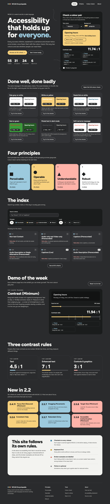

---

## Contents

1. [What the design is](#1-what-the-design-is)
2. [Rules the design never breaks](#2-rules-the-design-never-breaks)
3. [Colour](#3-colour)
4. [Typography](#4-typography)
5. [Layout and spacing](#5-layout-and-spacing)
6. [Shape, borders and depth](#6-shape-borders-and-depth)
7. [Motion](#7-motion)
8. [Components](#8-components)
9. [Pages](#9-pages)
10. [States](#10-states)
11. [Writing](#11-writing)
12. [Accessibility checklist for the build](#12-accessibility-checklist-for-the-build)
13. [The tweak bar](#13-the-tweak-bar)
14. [Token reference](#14-token-reference)
15. [Style switches (data attributes)](#15-style-switches-data-attributes)
16. [Hand-off notes](#16-hand-off-notes)
17. [Screenshot index](#17-screenshot-index)

---

## 1. What the design is

The site explains every Level A and AA success criterion of WCAG 2.2: 55 criteria, each in plain language, each shown broken and then fixed.

The Swatch direction is built around colour. The default page is a warm charcoal with three soft pastels: sky, sun and rose. The headline feature is the **colour check**, which shows two chosen colours used in a realistic layout, done well and done badly, with a live verdict against every contrast rule.

Character in one line: **friendly, confident, plainly useful**. Large rounded type, soft colour, generous space, and nothing decorative that gets in the way of reading.

The design has two themes:

| | Dark (default) | Light |
|---|---|---|
| Page | Charcoal `#2A2B2D` | Warm paper `#F4F3EF` |
| Panels | Near-black `#1A1C1C` | White |
| Text | Off-white `#F3F3F0` | Near-black `#1A1C1C` |
| Accents | Pastels used as fills, sky also as text | Pastels used as fills, dark teal `#1F5E7A` as text |

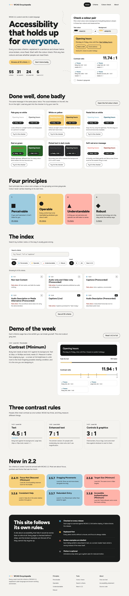

---

## 2. Rules the design never breaks

This is a site about accessibility, so its own design has to pass. These rules come before taste.

1. **Text contrast of 4.5:1 or more,** everywhere, in both themes. Large text (24px, or 18.66px bold) may go to 3:1, but the design does not rely on that.
2. **Control and graphic contrast of 3:1 or more.** Field borders, chip borders, focus rings, icons and the principle shapes must reach 3:1 against what is next to them (criterion 1.4.11).
3. **Colour never carries meaning alone.** Each principle has a colour and a shape. Pass and fail always show an icon (✓ or ✗) and a word. Links in body text are underlined.
4. **Focus is always visible.** A 3px outline in the focus colour, 3px offset, on every interactive element.
5. **Targets are at least 44 by 44px.** Chips, buttons, nav links, checkboxes with their labels, and the swap button all meet this.
6. **Broken examples cannot hurt anyone.**
   - Failing sample text is drawn with a CSS pseudo-element and hidden from assistive technology with `aria-hidden`.
   - Its badge describes it in words, for example "Badly · 2.05 : 1".
   - A screen reader hears the description, never the unreadable text.
7. **Nothing moves if you've asked it not to.** All transitions stop under `prefers-reduced-motion`, and the tweak bar's motion switch can turn hover movement off.
8. **Pages reflow to 390px without sideways scrolling.** Grids collapse to one column, and the decorative loop lines disappear.
9. **One h1 per page, headings in order, landmarks on every page:** skip link, header, nav, main and footer.
10. **Live changes are announced.** The colour check's verdict, result counts in the index and the tweak bar's status line use polite live regions. Updates are delayed slightly so a screen reader isn't flooded while someone drags a picker.

Every page passes an automated axe scan against WCAG 2.0, 2.1 and 2.2 at Levels A and AA, plus axe's best-practice rules, in both themes at both widths. axe does not measure border contrast, so rule 2 is checked by the tweak bar's audit and by the table in [section 3](#3-colour).

---

## 3. Colour

### 3.1 Surfaces and text

| Token | Role | Dark | Light |
|---|---|---|---|
| `--bg` | Page background | `#2A2B2D` | `#F4F3EF` |
| `--deep` | Panels: colour check, filters, demo lab, stages | `#1A1C1C` | `#FFFFFF` |
| `--raise` | Raised surfaces, hover backgrounds | `#323336` | `#FFFFFF` |
| `--card-bg` | Cards (defaults to `--raise`) | `#323336` | `#FFFFFF` |
| `--ink` | Main text | `#F3F3F0` | `#1A1C1C` |
| `--ink-2` | Secondary text: ledes, captions, meta | `#C3C3BE` | `#4A4B4F` |
| `--line` | Dividers and decorative card edges (not controls) | `#4A4B4F` | `#D6D4CE` |
| `--line-2` | Borders of controls: fields, chips, outline buttons | `#8A8B90` | `#7A7A7E` |
| `--focus` | Focus ring | `#F8D17D` (sun) | `#1A1C1C` |
| `--exhibit` | Background of the Demo of the week exhibit | `#121313` | `#121313` |

### 3.2 Accents

| Token | Name | Value | Used for |
|---|---|---|---|
| `--a1` | Sky | `#9CCADE` | Perceivable, links and accent text (dark), "Fixed" labels, pass text (dark) |
| `--a2` | Sun | `#F8D17D` | Operable, primary buttons, "New in 2.2" tags, focus ring (dark), sliders |
| `--a3` | Rose | `#FFB3A9` | Understandable, "Broken" labels, error text (dark) |
| `--a4` | White / stone | `#FFFFFF` dark, `#E4E2DC` light | Robust |
| `--on-a` | Ink on accents | `#1A1C1C` | All text and shapes on pastel fills |
| `--a-ink` | Dark accent | `#1F5E7A` | Accent text, links and pass text in the light theme |
| `--err-text` | Error and fail text | `--a3` dark, `#A83226` light | "Fails when:", ✗ Fails |
| `--ok-text` | Pass text | `--a1` dark, `--a-ink` light | ✓ Passes |

Pastels are **fills**, never text, in the light theme. On white or paper they fall to about 1.5–2:1. In the dark theme sky and rose are bright enough to be used as text.

Four palettes are available in the tweak bar. Karma is the default.

| Palette | Accent 1 | Accent 2 | Accent 3 | Dark accent |
|---|---|---|---|---|
| Karma | `#9CCADE` | `#F8D17D` | `#FFB3A9` | `#1F5E7A` |
| Citrus | `#A8DDB5` | `#F6E27A` | `#FFB37A` | `#2F6B3A` |
| Mineral | `#B9C4E6` | `#E8C9A0` | `#A9C7B9` | `#34477E` |
| Berry | `#F2A7C3` | `#FFD59E` | `#A6D8E8` | `#8E2A55` |

### 3.3 Principle colours and shapes

Each principle has a colour **and** a shape, so the grouping survives greyscale and colour blindness. Use them together everywhere a principle is marked: index cards, filters, facts tables. The home page's principle cards pair the colour with the principle's number, set large, instead of the shape.

| Principle | Colour | Shape | Criteria |
|---|---|---|---|
| 1 Perceivable | Sky `--a1` | Square | 20 |
| 2 Operable | Sun `--a2` | Circle | 20 |
| 3 Understandable | Rose `--a3` | Triangle | 13 |
| 4 Robust | White/stone `--a4` | Diamond (a square rotated 45°) | 2 |

### 3.4 Measured contrast (default design)

| Pair | Needs | Dark | Light |
|---|---|---|---|
| Main text on page | 4.5 | 12.7 | 15.4 |
| Secondary text on page | 4.5 | 8.0 | 7.8 |
| Secondary text on panels | 4.5 | 9.7 | 8.7 |
| Secondary text on cards | 4.5 | 7.1 | 8.7 |
| Accent text on page | 4.5 | 8.0 | 6.4 |
| Error text on page | 4.5 | 8.3 | 6.0 |
| Error text on cards | 4.5 | 7.4 | 6.7 |
| Ink on sky / sun / rose | 4.5 | 9.7 / 11.7 / 10.0 | same |
| Ink on Robust card | 4.5 | 17.1 | 13.2 |
| Pledge panel text | 4.5 | 15.4 | 15.4 |
| Control borders on page | 3 | 4.2 | 3.8 |
| Control borders on panels | 3 | 5.0 | 4.3 |
| Control borders on cards | 3 | 3.7 | 4.3 |
| Focus ring on page | 3 | 9.7 | 15.4 |
| Focus ring on panels | 3 | 11.7 | 17.1 |

The tightest pair is control borders on cards in the dark theme, at 3.7:1. Don't darken `--line-2` or lighten `--card-bg` without re-checking it. `--line-2` was `#6A6B70` in an earlier version, which failed at 2.4–2.7:1.

---

## 4. Typography

### 4.1 Fonts

| Role | Font | Weights loaded | Token |
|---|---|---|---|
| Headings, numbers, card titles, logo | **Figtree** | 400, 500, 600, 700, 800 | `--fh` |
| Body, labels, controls | **Onest** | 400, 500, 600, 700 | `--fb` |

The build self-hosts both (latin subset, `font-display: swap`; `docs/CONVENTIONS.md`). Figtree is a geometric sans with friendly rounded shapes and a strong heavy weight. Onest is a clear, open text face with generous spacing that reads well at small sizes.

The mockup also loads Gabarito, Golos Text, Bricolage Grotesque, Familjen Grotesk, Fraunces, Instrument Sans and Atkinson Hyperlegible so the tweak bar can switch between them. **The real build loads only Figtree and Onest.**

### 4.2 Scale

| Token | Used for | Value | Notes |
|---|---|---|---|
| `--h1` | Home headline | 96px | `max(48px, min(96px, 9vw))`, so it shrinks on narrow screens and never goes below half size |
| `--h1-sub` | Headline on other pages | 84px | `max(44px, min(84px, 7.5vw))` |
| `--h2` | Section headings | 64px | `max(36px, min(64px, 6vw))` |
| `--h3` | Card titles | 22px | Principle cards use 1.55×, rule cards 1.2× |
| `--num` | Big numbers: ratios, stats | 64px | Hero stats and the checker score use 0.7× |
| `--lede` | Intro paragraphs | 20px | |
| `--body` | Body text | 18px | |
| `--small` | Meta, captions, chips, footer | 15px | Never below 13px anywhere |
| `--eye` | Eyebrow above headlines | 16px | |
| `--ts` | Multiplier on every size | 1 | Scales the whole system |

| Token | Value | Applies to |
|---|---|---|
| `--hw` | 800 | Display: h1, h2, big numbers, principle titles |
| `--hw2` | 700 | Titles: cards, h3, pager, pledge items |
| `--bw` | 400 | Body |
| `--btn-w` | 500 | Buttons |
| `--lh` | 1.6 | Body line height |
| `--hlh` | 1 | Heading line height (h1 0.98) |
| `--hls` | −0.02em | Heading letter spacing (h1 −0.025em) |

### 4.3 Type rules

- Line length is capped: ledes at 52ch, section intros at 56ch, criterion explanations at 54ch.
- Sentence case everywhere. The only capitals are on the "Broken" and "Fixed" stage labels, set at 14px with 0.04em tracking.
- The accent word in a headline (*everyone.*, *Will people read it?*) is in `--accent-text`, not italic.
- Numbers in ratios are written `4.5 : 1` with spaces in big displays, and `4.5:1` inside sentences.

---

## 5. Layout and spacing

| Token | Value | What it controls |
|---|---|---|
| `--maxw` | 1240px | Content width |
| `--gut` | 56px | Side margins on desktop (20px under 900px) |
| `--sp` | 100px | Space above each section (×0.72 under 900px) |
| `--gap` | 18px | Gap between cards in every grid |
| `--pad` | 28px | Padding inside cards |
| `--hero-gap` | 32px | Gap between the home hero's text and the colour check |

**Grids**

| Component | Desktop | Under 1100px | Under 900px |
|---|---|---|---|
| Home hero | Text 6 / checker 5 | Stacked | Stacked |
| Done well, done badly | 3 columns | 2 | 1 |
| Principle cards | 4 | 2 | 1 |
| Index cards | 3 | 2 | 1 |
| Contrast rules, New in 2.2 | 3 | 2 (news) | 1 |
| Demo of the week | Info 5 / lab 7 | Stacked | Stacked |
| Criterion head | Text 7 / facts 4 | Stacked | Stacked |
| Broken and fixed | 2 | 2 | 1 |
| Footer | 2 / 1 / 1 / 1 | | Brand full width, then 2 columns |

**Breakpoints:** 1100px (four- and three-up grids drop to two) and 900px (phone layout).

**Section header pattern (`.bh`):** an h2 with a one-sentence intro, and an optional secondary button aligned to the bottom right. The button wraps underneath on narrow screens.

---

## 6. Shape, borders and depth

| Token | Value | Used on |
|---|---|---|
| `--rad` | 28px | Cards, panels, stages, principle cards. Tiles use 0.5×, preview 0.65×, index cards 0.8×, pledge 1.25× |
| `--rad-sm` | 12px | Fields, result boxes, the fix suggestion |
| `--rad-btn` | 999px | Buttons, nav pills (fully round) |
| `--rad-chip` | 999px | Chips, tags, stage labels |
| `--rad-badge` | 6px | Level badges (A, AA) |
| `--bwid` | 1.5px | Card, field and divider borders. Focus ring is always 3px |

**Depth:** flat by default. Cards are separated by surface colour, not shadow. The tweak bar offers a soft shadow (`0 12px 32px` at 16% black) and a hard offset (`6px 6px 0` in ink).

**Card style:** filled (default, `--card-bg`) or outlined (transparent with a `--line` border). In the light theme, cards always get a `--line` border, because white on paper is too subtle on its own.

---

## 7. Motion

| Token | Value | Behaviour |
|---|---|---|
| `--speed` | 0.15s | Hover and press |
| `--speed-state` | 0.3s | State changes in labs and stages, such as a verdict flip |
| `--ease-out` | `cubic-bezier(0.2, 0.7, 0.3, 1)` | The easing for `--speed-state`: fast start, gentle stop |
| `--lift` | 4px | Buttons and index cards rise by this on hover; principle cards by 1.5× |

Motion only ever shows a change the reader caused, and never carries meaning on its own:

- **Only opacity, transform and colour animate.** Never width, height, position or layout. (One older transition predates this rule: the colour preview's greyscale filter.)
- **Hover and press use `--speed`.** Buttons return to rest when pressed.
- **State changes use `--speed-state` with `--ease-out`.** A lab or stage changing because the reader changed something.
- **A verdict flip settles.** The verdict line changes colour and its text scales from 0.94 back to 1 (`.settle`, keyframes `lab-settle`). No shake, no bounce, no overshoot. The first render never animates.
- **Every animated change ends in a readable state and a text verdict**, so missing the animation loses nothing.
- **Banned:** scroll-triggered entrances, parallax, page transitions, loops, and anything that runs without the reader causing it. The dashed loop lines are static.
- The colour preview fades to greyscale over 0.2s when that option is checked.
- New work never transitions `filter`: the vision filter on labs and stages switches instantly.
- **`prefers-reduced-motion: reduce` and `data-motion="off"` make every change instant**: no transitions, no animations, no smooth scrolling. `data-motion="off"` also sets the lift to 0.

---

## 8. Components

Each component lists its tokens and behaviour. All screenshots are in `screenshots/components/`, in a `-dark` and a `-light` version.

### 8.1 Header and navigation

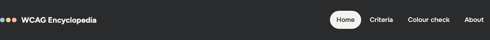

- Logo: three accent dots (sky, sun, rose) plus "WCAG Encyclopedia" in Figtree 700 at 20px.
- Nav links: Home, Criteria, Colour check, About. 17px Onest 500, 10px × 16px padding, 44px or more tall.
- Current page: `aria-current="page"`, shown as an ink pill (`--nav-on-bg` / `--nav-on-fg`). Two alternatives are available: an underline in the sun colour, and plain bold underlined text.
- On phones the links wrap under the logo.
- Every page starts with a "Skip to content" link, styled like a primary button when focused.

### 8.2 Buttons

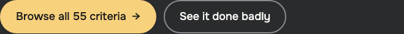

| Variant | Class | Look |
|---|---|---|
| Primary | `.btn.p` | Sun fill, ink text. One per screen at most |
| Secondary | `.btn.o` | Transparent, 2px `--line-2` border, ink text |
| Small | `.btn.sm` | 44px tall, 18px padding, 15px text. Used in cards |

- Height `--btn-h` 55px, side padding `--btn-px` 24px, weight 500, fully round.
- Label: a verb and an object ("Browse all 55 criteria", "Try it in the checker"). An arrow (→) may follow and is `aria-hidden`.
- Hover lifts by `--lift`; press returns to rest.

### 8.3 Home hero

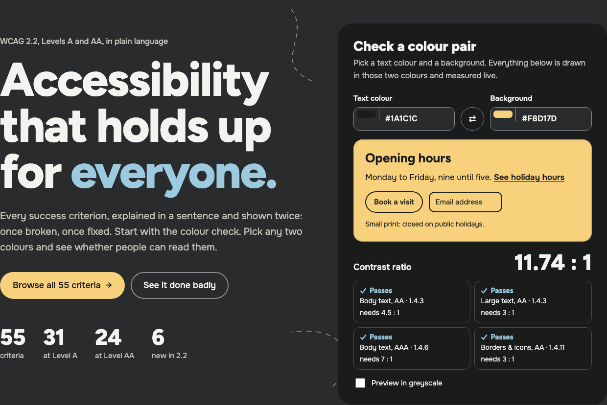

- Left column:
  - eyebrow
  - h1 ("Every WCAG criterion, *shown.*", at most 11 characters wide per line), with an eyebrow and lede that say this is an encyclopedia of WCAG 2.2
  - lede
  - primary and secondary buttons
  - stats row: 55 criteria / 31 at Level A / 24 at Level AA / 6 new in 2.2
- Right column: the colour check card.
- Stacked option (`data-hero="stacked"`): the checker goes full width under the text, with the preview on the right of the card.
- Dashed loop lines sit behind, never crossing text.

### 8.4 Colour check (the signature component)

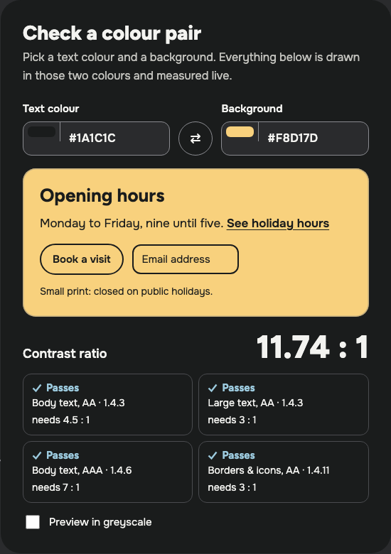

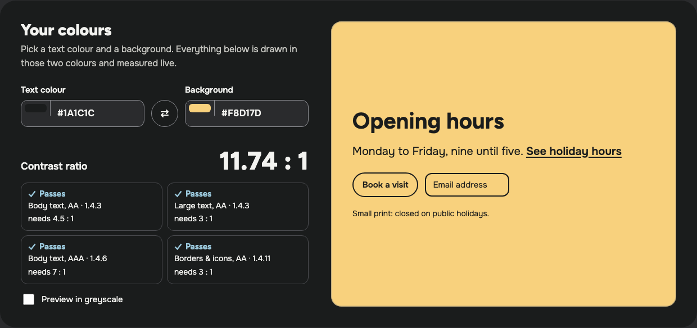

Anatomy, top to bottom:

1. **Title and one-line instruction.**
2. **Inputs:**
   - "Text colour" and "Background", each a fieldset with a legend, a native colour picker and a hex text field.
   - The hex field accepts 3- or 6-digit codes, with or without `#`.
   - A partly typed code is ignored until it is valid, and restored when the field loses focus.
   - A round **swap** button between them has the label "Swap text and background colours".
3. **Preview:** drawn entirely in the two chosen colours, so you see the pair in use and not as a swatch. It contains:
   - a 26px heading ("Opening hours")
   - a body sentence with an underlined link
   - an outlined button and an outlined field, both bordered in the text colour, which tests the 3:1 rule
   - small print at 14px

   The preview has a faint inner edge so a white background still reads as a box on a white card.
4. **Score:** the ratio in Figtree 800, truncated (not rounded) to two decimals, so 4.499 shows as 4.49 and never falsely passes.
5. **Results:** four boxes, each with an icon, "Passes" or "Fails", the rule and the threshold:
   - Body text AA, 4.5:1 (1.4.3)
   - Large text AA, 3:1 (1.4.3)
   - Body text AAA, 7:1 (1.4.6)
   - Borders and icons AA, 3:1 (1.4.11)
6. **Fix suggestion:** appears when body text fails.
   - It finds the closest colour of the same hue that reaches 4.5:1 by mixing towards black and towards white, and keeps the smaller change.
   - A button applies it, for example "Use #767676".
7. **Preview in greyscale** checkbox.
8. **Live verdict** for screen readers, announced half a second after the last change: "2.84 to 1. Fails for text and for controls."

On the Colour check page the card is wide: inputs and results on the left, a large preview on the right. Quick-start chips above it load common pairs ("Ink on paper", "Grey on white", and so on). Each chip shows two overlapping dots.

### 8.5 Done well, done badly

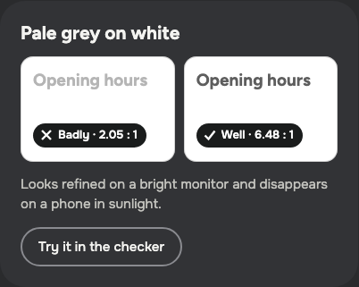

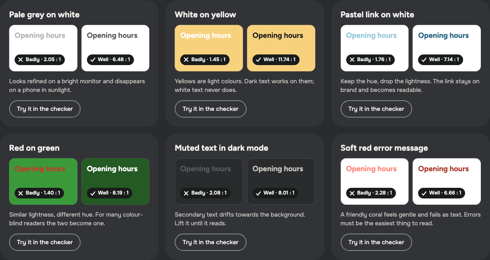

- Each card has a title naming the mistake, two tiles side by side (**badly** on the left, **well** on the right), one sentence of advice, and a "Try it in the checker" button that loads the bad pair and moves focus to the text-colour field.
- Each tile has a sample word ("Opening hours") in the pair's colours and a dark badge: "✗ Badly · 2.05 : 1" or "✓ Well · 6.48 : 1".
- The badly tile's sample text is a pseudo-element hidden from assistive technology. The badge carries the meaning and includes the hex codes for screen readers.
- The six pairs:

  | Pair | Badly | Well |
  |---|---|---|
  | Pale grey on white | `#B5B5B5` on `#FFFFFF` | `#5E5E5E` on `#FFFFFF` |
  | White on yellow | `#FFFFFF` on `#F8D17D` | `#1A1C1C` on `#F8D17D` |
  | Pastel link on white | `#9CCADE` on `#FFFFFF` | `#1F5E7A` on `#FFFFFF` |
  | Red on green | `#D0312D` on `#3A9A3A` | `#FFFFFF` on `#245A24` |
  | Muted text in dark mode | `#5A5B5F` on `#2A2B2D` | `#C3C3BE` on `#2A2B2D` |
  | Soft red error message | `#FF8A80` on `#FFFFFF` | `#A83226` on `#FFFFFF` |

### 8.6 Principle cards

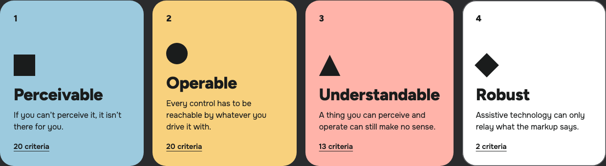

- Four cards in the principle colours. Each is marked by its number, set large (1.5× `--num`) in ink in place of a shape, then the name (h3, 1.55× card-title size), a one-line idea, and an underlined count link ("20 criteria").
- The whole card is one link to the filtered index (`criteria.html?p=1` and so on).
- Minimum height `--pc-h` 340px (×0.68 on phones).
- The Robust card is white, so it gets a `--line` inner edge.
- A plain alternative (`data-princ="mono"`) shows the cards in the card colour with the numbers in ink.

### 8.7 Filters and chips

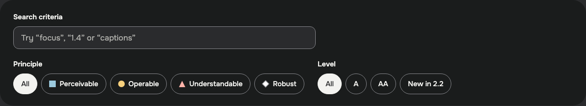

- A panel in `--deep` holding:
  - a search field (labelled "Search criteria", hint "Try "focus", "1.4" or "captions"")
  - principle chips: All plus four, each with its shape marker
  - level chips: All, A, AA and "New in 2.2"
- Chips are toggle buttons with `aria-pressed`, at least 44px tall and fully round. Selected chips are ink-filled.
- Search matches the number, name, plain explanation and "fails when" text.
- A results line below ("Showing 6 of 55 criteria.") is a polite live region.
- If nothing matches, a dashed box suggests what to try.

### 8.8 Index cards

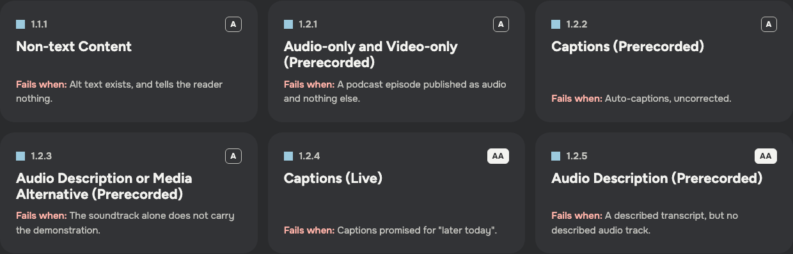

- The whole card is a link to the criterion page.
- Top row: shape marker, number, an optional "New in 2.2" tag, and the level badge on the right.
- Then the name (h3, 22px Figtree 700) and, at the bottom, "**Fails when:** …" with the label in `--err-text`. This line can be hidden with `data-failline="off"`.
- The principle name is in the link for screen readers but not shown, because the marker shows it.

### 8.9 Level badges and tags

- **A:** outline badge, `--ink-2` border, 12px Onest 700, 6px corners.
- **AA:** solid ink badge, which can be set to outline. "Level" is in the accessible name but hidden visually.
- **New in 2.2:** a sun pill.
- **Stage labels:** "✗ Broken" in rose and "✓ Fixed" in sky, as capitals.

### 8.10 Demo of the week

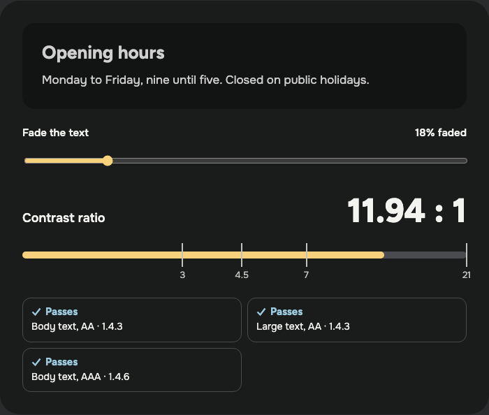

- Left: criterion meta, name and plain explanation.
- Right: a lab panel with:
  - an exhibit on `--exhibit` (sample heading and paragraph)
  - a labelled "Fade the text" slider, described for screen readers
  - the live ratio
  - a scale bar on a log scale with ticks at 3, 4.5, 7 and 21
  - three pass/fail boxes
- Moving the slider really does fade the exhibit text. That is the lesson, and it's under the user's control.

### 8.11 Contrast rules, and "what the numbers mean" cards

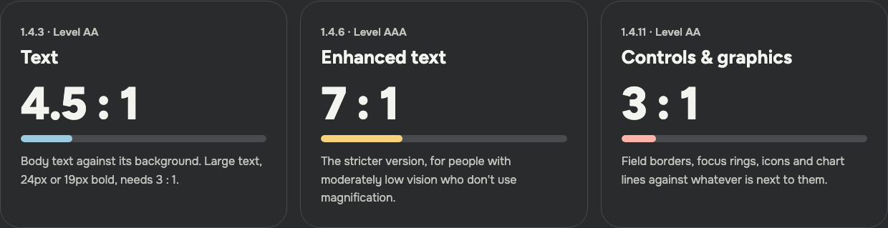

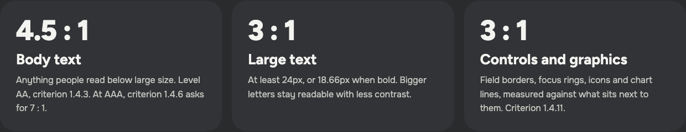

Three cards: Text 4.5:1, Enhanced text 7:1, Controls and graphics 3:1. Each has its criterion and level, the ratio at `--num`, a bar showing the ratio out of 21, and one sentence. The bars are decorative and the numbers carry the meaning.

### 8.12 New in 2.2

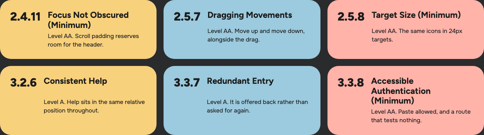

Six link cards in rotating sun, sky and rose. Each has the number in Figtree 800 at 30px, the name, and "Level X." followed by the criterion's "passes when" sentence.

### 8.13 Pledge panel

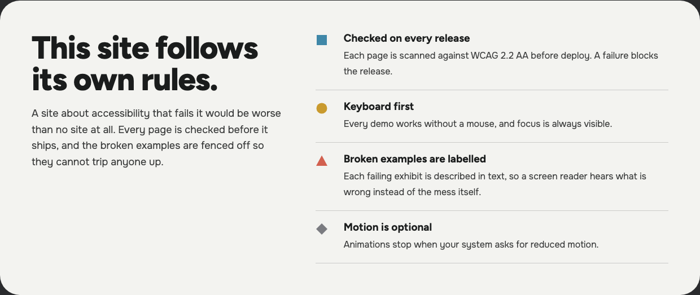

- An inverted panel: light in the dark theme, dark in the light theme.
- The heading "This site meets the criteria it explains.", a paragraph, and four commitments, each marked with a principle shape:
  - checked on every release
  - keyboard first
  - broken examples are labelled
  - motion is optional

### 8.14 Criterion page parts

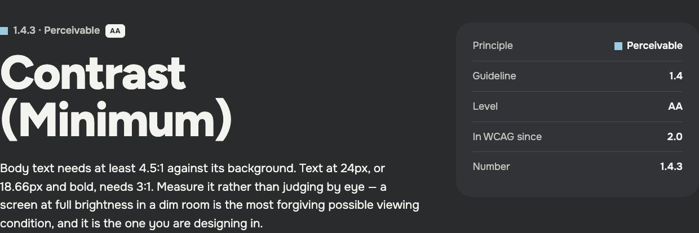

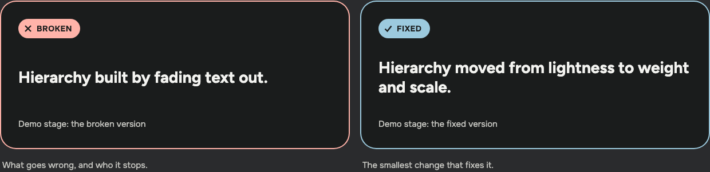

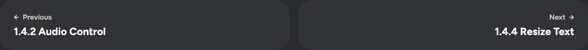

- **Breadcrumb:** Home / Criteria / *current*, in a labelled nav, with the current item marked `aria-current="page"`.
- **Head:**
  - meta line: marker, number, principle, level and an optional New tag
  - h1 with the criterion name
  - the plain explanation at lede size
- **Facts card:** principle, guideline, level, "In WCAG since" (2.0, 2.1 or 2.2) and number.
- **Broken, then fixed:** two stages. Each has a label, the criterion's fail or pass caption as a large quote, and a note marking where the live demo mounts. Rose and sky inner edges in dark; neutral edges in light.
- **Try it with your own colours:** the colour check, shown only on contrast-related criteria (1.4.1, 1.4.3, 1.4.11).
- **Also in guideline X.Y:** up to six index cards from the same guideline, or from the same principle if the guideline has no others.
- **Pager:** previous and next criteria in number order.

### 8.15 Footer

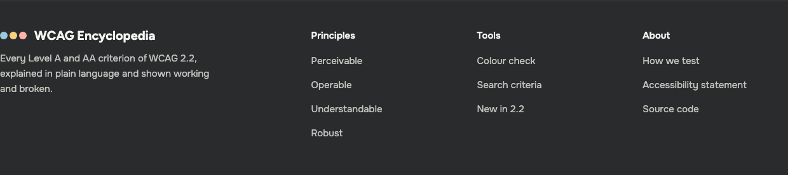

Logo and a one-line description, then three link columns: Principles, Tools and About. 15px text in `--ink-2`, links underline on hover, and the top border is `--line`.

### 8.16 Dashed loop lines

- Decorative SVG paths behind headers: 1.6px stroke in `--loop`, dashes of 10 with 9 gaps.
- They are `aria-hidden`, ignore the pointer, sit behind content, never cross text, and are removed under 900px.
- Colour, thickness, dash length and opacity are all tokens. `data-loops="off"` removes them.

---

## 9. Pages

### 9.1 Home (`index.html`)

Sections, in order:

1. Hero with the colour check
2. Done well, done badly
3. Four principles
4. The index: filters and six cards, then "See all 55 criteria"
5. Demo of the week
6. Three contrast rules
7. New in 2.2
8. The pledge

| Dark | Light | Phone |
|---|---|---|
|  |  |  |

### 9.2 Colour check (`contrast.html`)

Sections, in order:

1. Page head with eyebrow, h1 "Colour check. *Will people read it?*" and the preset chips
2. The wide checker
3. Done well, done badly
4. What the numbers mean
5. What a ratio can't tell you: thin fonts, text over images, states, and colour as the only signal

URL parameters `?fg=` and `?bg=` preload a pair.

| Dark | Light | Phone |
|---|---|---|
| 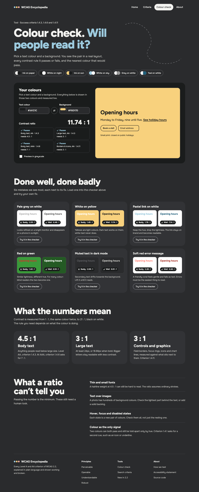 | 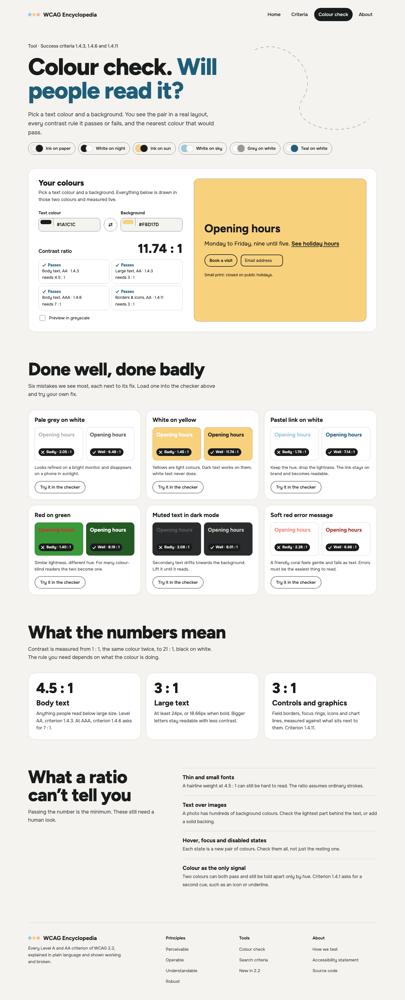 |  |

### 9.3 All criteria (`criteria.html`)

- Page head with h1 "All 55 criteria", plus a "How they split by principle" chart on the right with a marker, name, count and bar for each principle.
- Then the full filterable index.
- URL parameters: `?p=1` to `?p=4` for a principle, `?q=` for a search, and `?new` for criteria new in 2.2.

| Dark | Light | Phone |
|---|---|---|
| 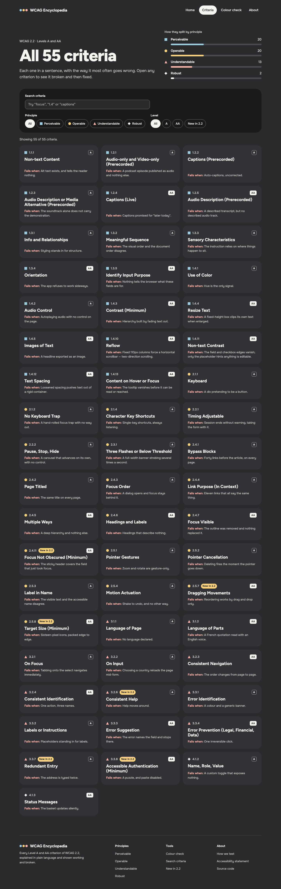 | 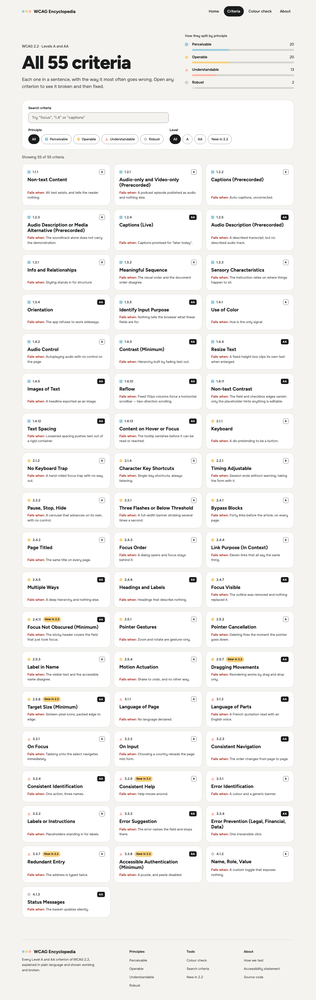 |  |

### 9.4 Criterion (`criterion.html?c=1.4.3`)

The page parts are listed in [8.14](#814-criterion-page-parts). Screenshots show 1.4.3, which includes the colour check, and 2.4.11, which is new in 2.2 and has no checker.

| 1.4.3 dark | 1.4.3 light | 2.4.11 dark | Phone |
|---|---|---|---|
| 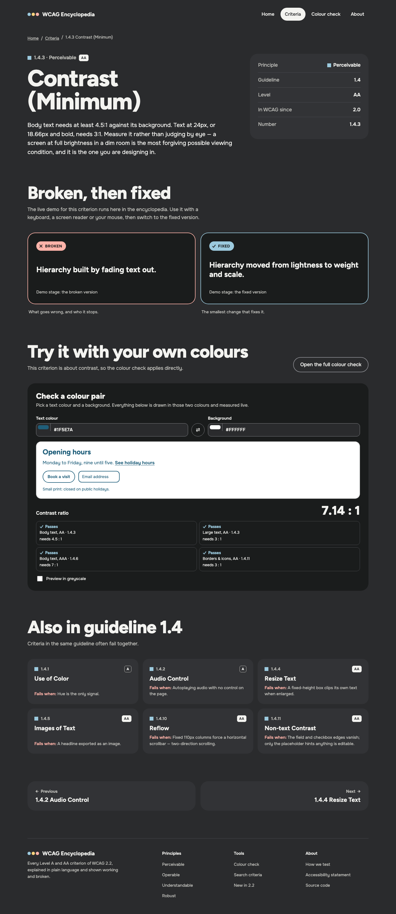 | 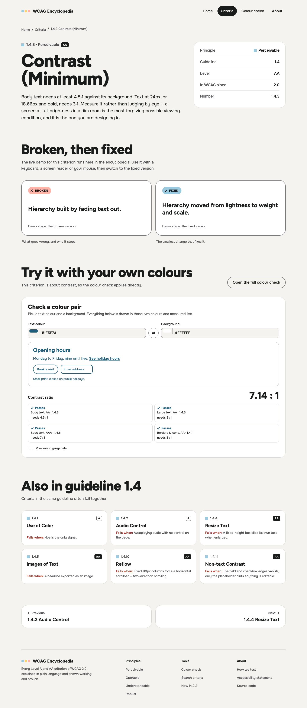 | 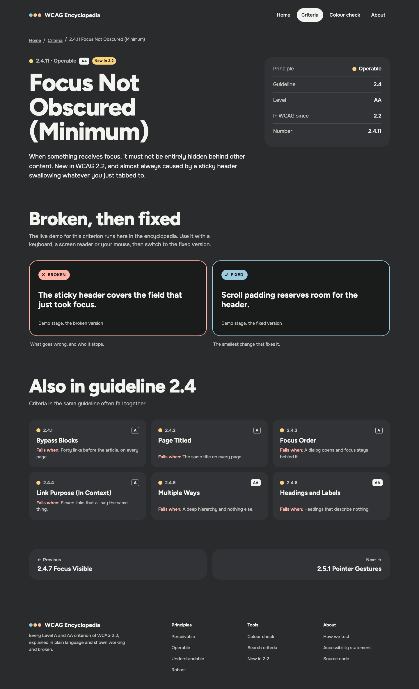 |  |

---

## 10. States

| State | Screenshot |
|---|---|
| Colour check failing, with fix suggestion | 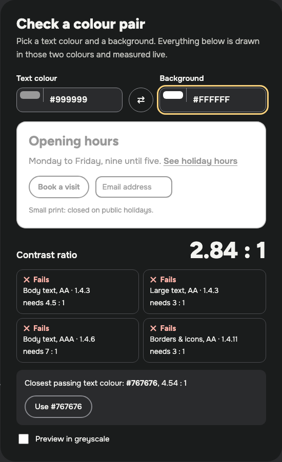 |
| Preview in greyscale | 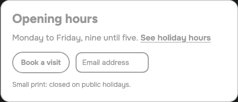 |
| Focus ring on the logo link | 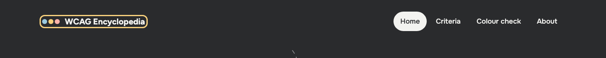 |
| Focus ring on the primary button | 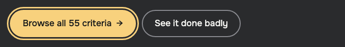 |
| Index filtered to Operable | 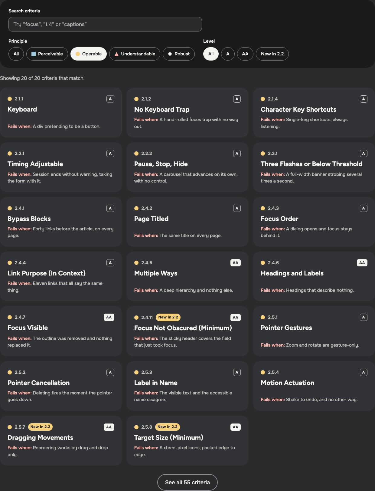 |
| Index with no results | 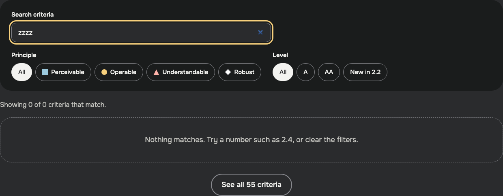 |
| Demo of the week faded until it fails | 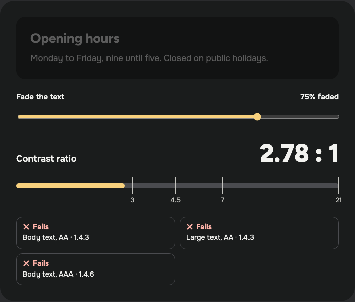 |

---

## 11. Writing

- **Plain language.** Explain each criterion in a sentence a non-specialist understands. Say what goes wrong ("Fails when:") before the rule.
- **British spelling:** colour, recognise, centre.
- **Sentence case** for headings, buttons and labels.
- **Buttons are a verb and an object:** "Browse all 55 criteria", "Open the full colour check", "Use #767676".
- **Numbers carry their unit:** "4.5 : 1", "24px", "55 criteria".
- **Never rely on position or colour in instructions.** Write "the Text colour field", not "the box on the left".
- **Broken examples are described, not just shown.** Every failing exhibit has a text description of what is wrong.
- Criterion names, numbers, plain explanations and fail and pass captions come from the corpus generated from `src/criteria/*.tsx`. Don't retype them into components.

---

## 12. Accessibility checklist for the build

Check each item on every new page or component:

- [ ] Skip link to `#main`; landmarks for header, nav (labelled "Main"), main and footer; one h1; headings in order.
- [ ] All text meets 4.5:1 and controls meet 3:1 in **both** themes. Run the tweak bar audit, or the table in 3.4.
- [ ] Focus visible on every interactive element (3px `--focus` outline, 3px offset). Nothing removes outlines without replacing them.
- [ ] Targets at least 44 × 44px.
- [ ] Toggle buttons use `aria-pressed`. Expanding controls use `aria-expanded` and `aria-controls`.
- [ ] Results, verdicts and status messages update a polite live region and don't steal focus.
- [ ] Colour inputs have visible labels (a fieldset legend) and accessible names for both the picker and the hex field.
- [ ] Failing examples are `aria-hidden` and have a text equivalent.
- [ ] Decorative SVGs are `aria-hidden`. Meaningful SVGs have a title or label.
- [ ] Works at 390px wide with no sideways scrolling, and at 200% and 400% zoom.
- [ ] Reduced motion stops every transition.
- [ ] axe scan with WCAG 2.0, 2.1 and 2.2 A and AA plus best-practice rules shows 0 violations. The repository's deploy is already gated on this.

---

## 13. The tweak bar

> **Do NOT include the tweak bar in the build.** It exists only in the mockup, for choosing values. Do not ship:
> - the Tweaks button or panel
> - `tweak.js`
> - the `.tw-*` styles
> - the `swatch-tweaks-v2` storage
> - the `?tweaks` URL parameter
>
> The build gets the chosen values through **Copy CSS** or the `:root` block in `swatch.css`, and nothing else from this section.

The tweak bar is a design tool built into the mockup. Open it with the **Tweaks** button at the bottom right, or add `?tweaks` to any page URL.

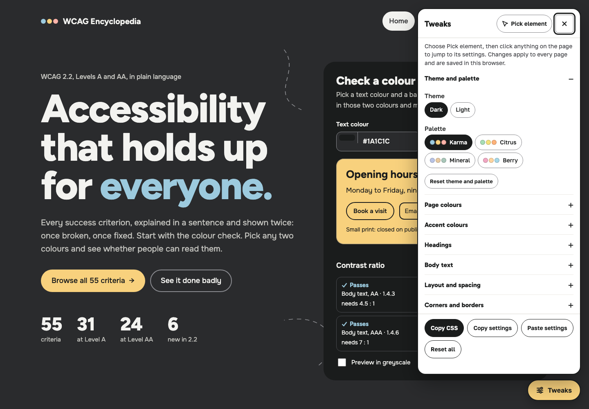

**Groups:**
- Theme and palette
- Page colours
- Accent colours
- Headings
- Body text
- Layout and spacing
- Corners and borders
- Buttons
- Navigation
- Cards and panels
- Principle cards
- Filters, chips and badges
- Colour check and demos
- Dashed loop lines
- Pledge panel and footer
- Motion

Each group has its own reset button.

**Pick element:** choose it, then click anything on the page. The panel opens that element's group. A label follows the pointer naming the element. Press Escape to stop.

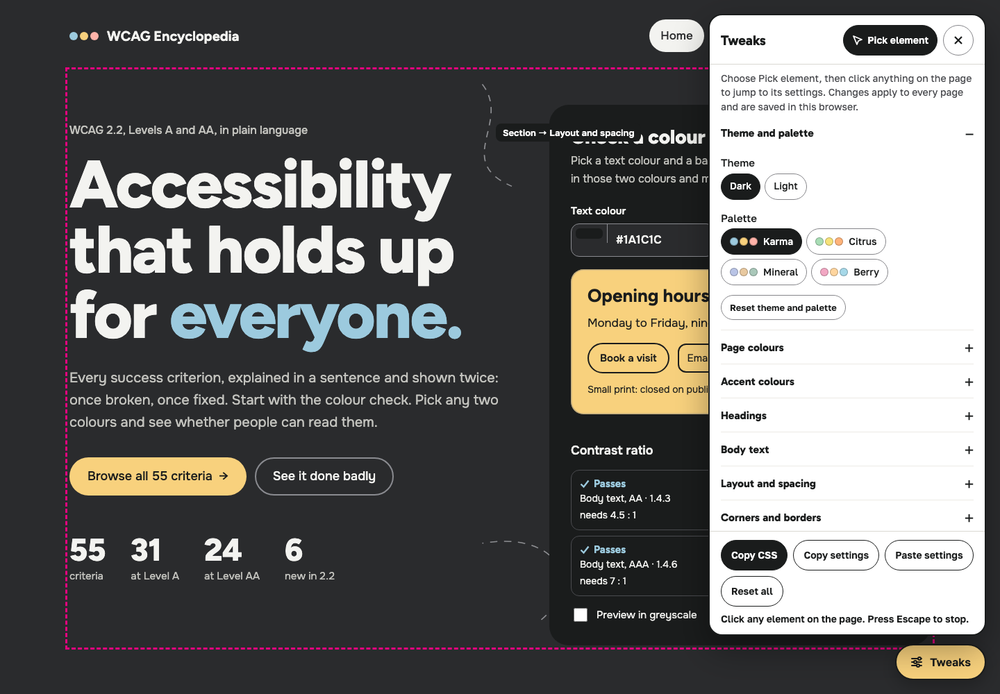

**Does it still pass?** checks 18 colour pairings against the contrast rules live, including control borders on page, panels and cards, and counts any problems.

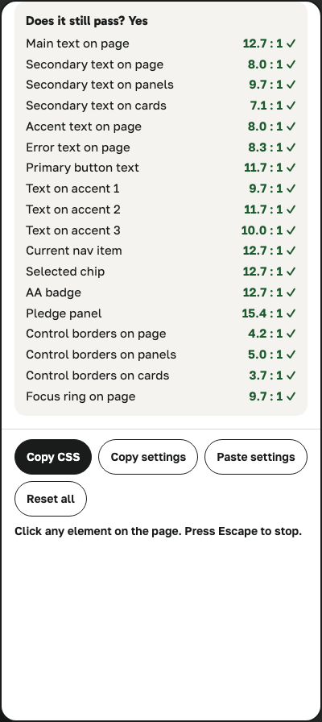

**Export:**
- **Copy CSS** gives a `:root{…}` block of all token values, plus the style switches to set on `<html>`. Paste it over the `:root` block in `swatch.css`, or into the build's token file.
- **Copy settings** and **Paste settings** move a set of tweaks between browsers, or into a chat.
- **Reset all** returns to the design in this guide.

Settings are saved in the browser (`localStorage`, key `swatch-tweaks-v2`) and carry across pages.

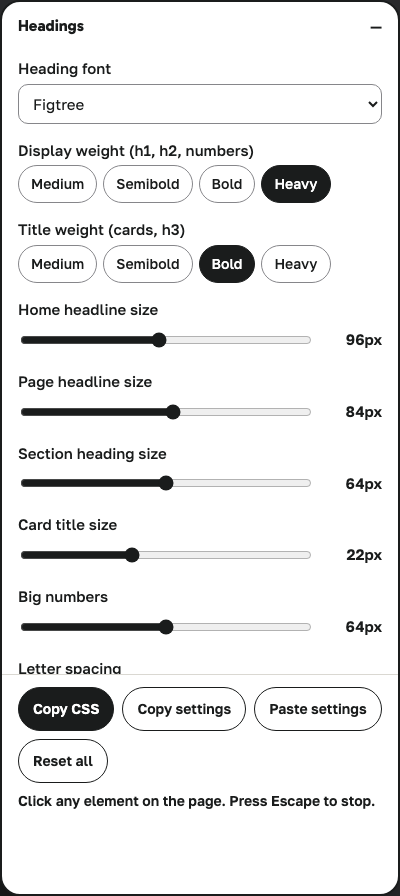

---

## 14. Token reference

Default (dark) values. Light-theme overrides are in [section 3](#3-colour).

| Group | Token | Default |
|---|---|---|
| Colour | `--bg` `--deep` `--raise` | `#2A2B2D` `#1A1C1C` `#323336` |
| | `--ink` `--ink-2` | `#F3F3F0` `#C3C3BE` |
| | `--line` `--line-2` | `#4A4B4F` `#8A8B90` |
| | `--a1` `--a2` `--a3` `--a4` | `#9CCADE` `#F8D17D` `#FFB3A9` `#FFFFFF` |
| | `--a-ink` `--on-a` | `#1F5E7A` `#1A1C1C` |
| | `--accent-text` `--err-text` `--ok-text` `--focus` | `var(--a1)` `var(--a3)` `var(--a1)` `var(--a2)` |
| | `--exhibit` `--pledge-bg` `--pledge-fg` `--foot-bg` | `#121313` `#F3F3F0` `#1A1C1C` `transparent` |
| Type | `--fh` `--fb` | `"Figtree"` `"Onest"` |
| | `--hw` `--hw2` `--bw` `--ts` | `800` `700` `400` `1` |
| | `--h1` `--h1-sub` `--h2` `--h3` `--num` | `96px` `84px` `64px` `22px` `64px` |
| | `--lede` `--body` `--small` `--eye` | `20px` `18px` `15px` `16px` |
| | `--lh` `--hlh` `--hls` | `1.6` `1` `-.02em` |
| Layout | `--maxw` `--gut` `--sp` | `1240px` `56px` `100px` |
| | `--gap` `--pad` `--hero-gap` | `18px` `28px` `32px` |
| Shape | `--rad` `--rad-sm` `--rad-btn` `--rad-chip` `--rad-badge` | `28px` `12px` `999px` `999px` `6px` |
| | `--bwid` | `1.5px` |
| Buttons | `--btn-h` `--btn-px` `--btn-w` | `55px` `24px` `500` |
| | `--btn-bg` `--btn-fg` `--btn2-line` | `var(--a2)` `var(--on-a)` `var(--line-2)` |
| Navigation | `--nav-on-bg` `--nav-on-fg` `--nav-gap` | `var(--ink)` `var(--bg)` `6px` |
| Cards | `--card-bg` `--lift` `--pc-h` `--prev-pad` | `var(--raise)` `4px` `340px` `24px` |
| Chips and badges | `--chip-on-bg` `--chip-on-fg` `--badge-bg` `--badge-fg` | `var(--ink)` `var(--bg)` `var(--ink)` `var(--bg)` |
| Loops | `--loop` `--loop-w` `--loop-dash` `--loop-o` | `#8E8F93` `1.6px` `10px` `1` |
| Motion | `--speed` | `.15s` |

---

## 15. Style switches (data attributes)

Set on `<html>`. The defaults are listed first.

| Attribute | Values | Effect |
|---|---|---|
| `data-theme` | `dark`, `light` | Swaps the colour set |
| `data-nav` | `pill`, `underline`, `plain` | How the current nav item is marked |
| `data-cards` | `filled`, `outline` | Card surfaces |
| `data-shadow` | `none`, `soft`, `hard` | Shadow on cards and panels |
| `data-loops` | `on`, `off` | Dashed loop lines |
| `data-hero` | `split`, `stacked` | Home hero layout |
| `data-motion` | `on`, `off` | Hover movement and transitions |
| `data-eyebrow` | `normal`, `caps` | Eyebrow in sentence case or spaced capitals |
| `data-badges` | `solid`, `outline` | Level AA badge |
| `data-princ` | `colour`, `mono` | Principle cards in accent colours or plain |
| `data-failline` | `on`, `off` | "Fails when" line on index cards |

---

## 16. Hand-off notes

**Files in the mockup (`design/mockups/swatch/`)**

| File | What it is |
|---|---|
| `swatch.css` | Every token and component style. The tweak bar's own styles are at the end, marked "never tweaked". |
| `site.js` | Shared code: colour maths (relative luminance, ratio, nearest passing colour), data loading, header and footer, the colour check, the pairs and the index. |
| `tweak.js` | The tweak bar. **Do not include in the build.** |
| `index.html`, `contrast.html`, `criteria.html`, `criterion.html` | The four page templates. |
| `../corpus.js` | Criterion data generated from `src/criteria/*.tsx`, as `[number, name, level, plain, failCaption, passCaption]`. |

**For the real build**

- **Do NOT include the tweak bar.** Leave out:
  - `tweak.js`
  - the `.tw-*` rules at the end of `swatch.css`, under "tweak bar (fixed design, never tweaked)"
  - the `tweak.js` script tag on each page
  - the Tweaks button
- Load only Figtree (400–800) and Onest (400–700).
- Keep the colour maths exactly as written in `site.js`:
  - WCAG relative luminance with the 0.03928 threshold
  - ratios truncated, not rounded
  - nearest pass found by mixing towards black and towards white
- The colour check's verdict announcement is delayed by 500ms on purpose. Don't remove the delay.
- The theme should follow `prefers-color-scheme` on first visit, then remember the user's choice. The mockup defaults to dark.
- The "Broken" and "Fixed" stages on criterion pages are where the existing demo components from `src/criteria/` mount.

**Placeholders and gaps**

- The About, Accessibility statement and Source code links don't go anywhere yet.
- There is no search results page. Search filters the index in place.
- There is no theme toggle outside the tweak bar. The build needs a visible, labelled one.
- Text over images is not used anywhere. If photography is added, it needs a solid backing behind any text.

---

## 17. Screenshot index

All paths are relative to `design/new-design/screenshots/`.

**pages/:** each page in `dark` and `light`, at `desktop` (1440px) and `phone` (390px), named `<page>-<theme>-<width>.png`:
- `home`
- `colour-check`
- `all-criteria`
- `criterion-1-4-3`
- `criterion-2-4-11`

**components/:** each in `-dark.png` and `-light.png`:
- `header-nav`
- `hero`
- `buttons`
- `colour-check-card`
- `colour-check-wide`
- `preset-chips`
- `pair-card`
- `pairs-grid`
- `principle-cards`
- `filters`
- `index-cards`
- `demo-lab`
- `contrast-rules`
- `learn-cards`
- `new-in-2-2`
- `pledge`
- `criterion-head`
- `broken-fixed`
- `pager`
- `criteria-head`
- `footer`

**states/:**
- `colour-check-failing-with-fix`
- `colour-check-greyscale`
- `focus-ring-nav`
- `focus-ring-button`
- `index-filtered-operable`
- `index-no-results`
- `demo-lab-failing`
- `tweak-bar-open`
- `tweak-bar-pick-element`
- `tweak-bar-headings-group`
- `tweak-bar-contrast-audit`
